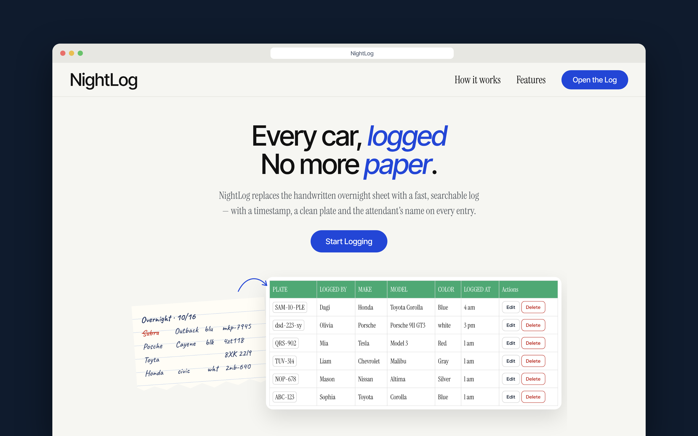

# NightLog

NightLog is a  web app for keeping an overnight car log. Instead of passing around a handwritten sheet, attendants can record a vehicle, see the shift's entries, and correct or remove mistakes.


## Demo



## What it does

- Add car entries with a plate, attendant name, make, model, color, and logged time.
- View entries on the Tonight page, sorted by logged time.
- Edit or delete an entry.
- Create an account and log in.
- Choose a make from a dropdown to keep entries consistent.

The visual direction was inspired by interface and dashboard designs on Dribbble, then adapted for NightLog's overnight-log use case.

## Built with

- Node.js and Express
- EJS templates
- MongoDB Atlas, accessed through Mongoose
- Passport Local for login and signup
- Express sessions for login state

## Getting started

### Requirements

- Node.js and npm
- A MongoDB database and connection URI

### Install dependencies

```sh
npm install
```

### Configure environment variables

Create a `.env` file in the project root:

```dotenv
MONGODB_CONNECTIION=mongodb+srv://<username>:<password>@<cluster-url>/NightLog?retryWrites=true&w=majority
SESSION_SECRET=replace-with-a-long-random-secret
```

Replace the MongoDB URI placeholders with your Atlas connection details. URL-encode any special characters in the username or password. Keep `.env` private; do not commit it or share the URI.

> The application currently reads the MongoDB variable as `MONGODB_CONNECTIION` (with three consecutive “i” characters in `CONNECTIION`). Use that exact spelling in `.env` unless you also update `server.js`.

### Start the app

```sh
npm start 
```

Then visit [http://localhost:8000](http://localhost:8000).

## Main pages

| Path | Purpose |
| --- | --- |
| `/` | Landing page |
| `/signup` | Create an account |
| `/login` | Log in |
| `/tonight` | View the car log |
| `/addlog` | Add an entry |
| `/logs/:id/edit` | Edit an entry |

Car entries are stored in the MongoDB `CarCollection` collection. User accounts are stored through the Mongoose `User` model.
